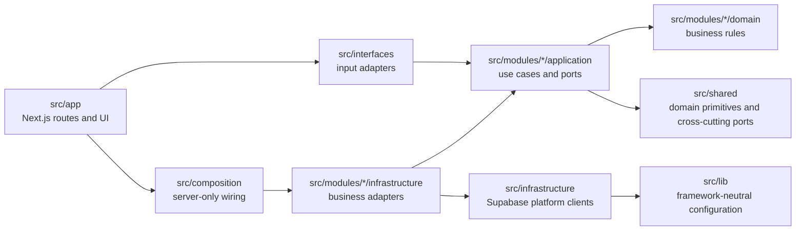

# Arquitectura del código

DecorAR es un monolito modular Next.js. Los módulos se despliegan juntos, pero sus dependencias respetan Clean Architecture.

## Ubicaciones

| Ruta | Responsabilidad |
|---|---|
| `src/app` | Páginas y Route Handlers exigidos por App Router. Los handlers adaptan HTTP; no implementan dominio ni persistencia. |
| `src/interfaces` | Controladores y adaptadores de entrada reutilizables invocados por Route Handlers. |
| `src/modules/*/domain` | Entidades y reglas sin React, Next.js, Supabase, Cloudinary ni capas externas. |
| `src/modules/*/application` | Casos de uso y puertos. Puede importar dominio; no adaptadores concretos. |
| `src/modules/*/infrastructure` | Implementaciones de puertos para persistencia, eventos o proveedores. |
| `src/infrastructure` | Clientes compartidos de plataforma. No contiene reglas de negocio. |
| `src/composition` | Construcción server-only de dependencias concretas. |
| `src/shared` | Primitivas de dominio y contratos transversales mínimos. |
| `src/lib` | Configuración neutral existente; no es una capa de negocio. |

## Reglas verificadas

| Regla | Permitido | Prohibido |
|---|---|---|
| `domain-external-framework` | TypeScript y dominio compartido | React, Next.js, Supabase, Cloudinary |
| `domain-internal-dependency` | Dominio del mismo módulo y `src/shared/domain` | Aplicación, infraestructura, interfaces, composition root |
| `application-internal-dependency` | Dominio y puertos | Infraestructura, interfaces, composition root |
| `interfaces-infrastructure-dependency` | Aplicación y dominio | Adaptadores concretos de infraestructura |
| `app-infrastructure-dependency` | Interfaces y composition root | Adaptadores concretos de infraestructura desde entradas server-side |
| `client-server-import` | UI y cliente Supabase browser | Adaptadores server/admin, `server-only`, composition root |
| `client-business-crud` | Auth y Realtime privados | `.from()` sobre catálogo, paquetes, elementos, presupuestos, eventos o plantillas |
| `packages-budget-coupling` | Eventos o puertos compartidos | Import directo desde packages hacia budget |

`scripts/scan-architecture.test.ts` valida el árbol real y casos negativos controlados. PostgREST es la Data API interna de Supabase, no un módulo ni despliegue separado.

DECOR-44 mantiene el mismo límite para las plantillas privadas de eventos. Los Route Handlers de `/api/event-templates` (y `PATCH /api/packages/{id}`) adaptan HTTP en `src/app/api`, delegan en `EventTemplateController`/`PackageController` en `src/interfaces`, validan sesión y propiedad con `checkEventTemplateAccess` o `checkPackageAccess`, y persisten mediante RPC `SECURITY INVOKER` de `service_role`. El navegador nunca escribe `event_templates`, `event_template_groups` ni `event_template_items`; RLS solo concede lectura al propietario.

El Composite editable (`editable-decorative-groups`) sigue el mismo límite: los Route Handlers `POST /api/packages/{id}/groups`, `PATCH|DELETE /api/packages/{id}/groups/{groupId}` y `PATCH /api/packages/{id}/items/{itemId}` adaptan HTTP en `src/app/api`, delegan en `PackageController` en `src/interfaces`, validan sesión y propiedad con `checkPackageAccess`, y persisten mediante las RPC `create_package_group`, `update_package_group`, `delete_package_group` y `move_package_item` (`SECURITY INVOKER`, `service_role`). El navegador no escribe `package_groups` ni `package_items`; no se añaden dependencias, tablas ni rutas paralelas.

DECOR-46 (`decor-46-scene-transforms`) persiste la posición y rotación horizontal de cada unidad del paquete fuera del módulo `packages`: `GET|PUT /api/packages/{id}/scene` adapta HTTP en `src/app/api`, delega en `SceneController` en `src/interfaces/ar`, valida sesión y propiedad con `checkPackageAccess`, y persiste mediante la RPC `save_package_scene` (`SECURITY INVOKER`, `service_role`) sobre `package_scenes`/`package_item_transforms`. El dominio y los casos de uso viven en `src/modules/ar`, que ya modelaba posición y rotación solo en memoria; la escena tiene su propia versión, separada de `packages.version`, y guardarla no emite eventos `package.module.*` ni recalcula el presupuesto. El navegador no escribe estas tablas; no se copia la escena al clonar un paquete ni en las plantillas de DECOR-44.

DECOR-53 (`decor-53-enlace-publico-cotizacion`) añade el único camino sin sesión de la aplicación, aparte de `/login` y `/signup`: `POST|GET|DELETE /api/quotes/{id}/share-link` adapta HTTP en `src/app/api`, delega en `QuoteShareLinkController` en `src/interfaces/quotes`, valida sesión y propiedad del dueño con `checkQuoteAccess`, y persiste mediante las RPC `create_quote_share_link` (idempotente), `get_quote_share_link` y `revoke_quote_share_link` (`SECURITY INVOKER`, `service_role`) sobre `private.quote_share_links`. La lectura pública es distinta: `src/app/(public)/c/[token]/page.tsx` no pasa por ningún controlador autenticado, sino por `GetSharedQuoteUseCase`, que llama a la RPC `get_shared_quote`; esta nunca lanza error, así que un token con formato inválido, inexistente, vencido, revocado o de una cotización que no está `sent`/`accepted` responde siempre `notFound()`, sin distinguir el motivo. `src/proxy.ts` declara `/c` como pública y le añade `Cache-Control: no-store` y `Referrer-Policy: no-referrer`, para que el token no quede en una caché intermedia ni viaje en un `Referer` posterior. El token se firma con HMAC-SHA256 sobre el id del enlace (`HmacShareTokenSigner`); la base de datos guarda solo su hash, nunca el token. `anon` sigue sin ningún permiso sobre `quotes` ni `quote_share_links` (regla de DECOR-30): la página pública usa el cliente `service_role` en el servidor, igual que las demás lecturas por RPC de este módulo.

En V2 (`DECOR-49` a `DECOR-52`, `DECOR-54` y `DECOR-56`), el módulo `src/modules/quotes` gestiona las cotizaciones versionadas con precios congelados (`POST /api/packages/{id}/quotes`, `GET /api/quotes`, `GET /api/quotes/{id}`, `POST /api/quotes/{id}/versions`, `PATCH /api/quotes/{id}/status`) mediante `QuoteController` (`checkPackageAccess` / `checkQuoteAccess`) y RPC `SECURITY INVOKER` de `service_role`. La generación de PDF (`DECOR-52`) vive en `ReactPdfQuoteRenderer` (`@react-pdf/renderer`, runtime Node.js) consumiendo `QuoteDocumentSource` desde `GET /api/quotes/{id}/pdf` (propietario) y `GET /api/c/{token}/pdf` (cliente sin sesión vía `SharedQuotePdfController` y `GetSharedQuoteUseCase`, con `Cache-Control: no-store` y `Referrer-Policy: no-referrer`). El recorrido guiado (`FlowSteps` en `src/app/(protected)/_flow/`) y el reparto por WhatsApp/Web Share (`whatsapp-share-actions.tsx`) permanecen en la capa de presentación sin acceder a infraestructura.
