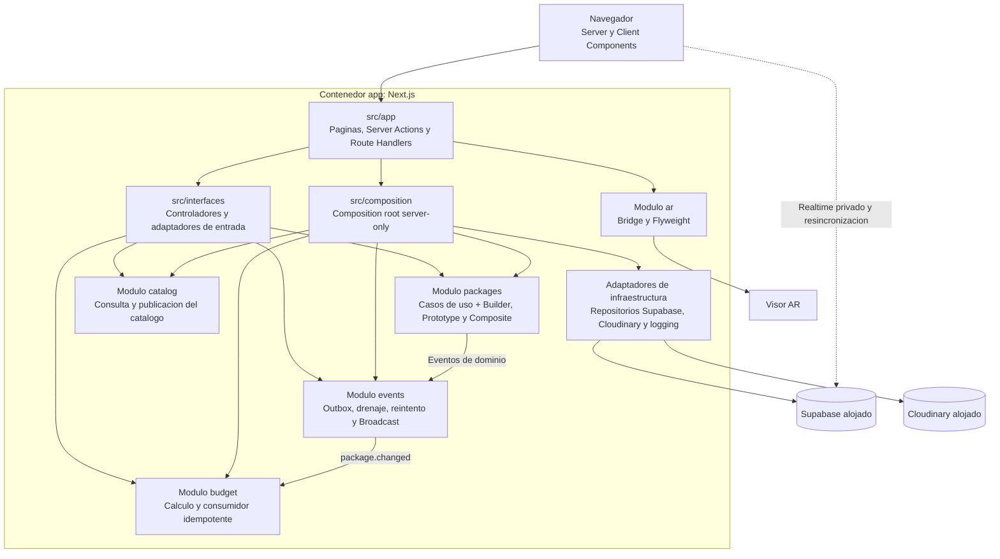

# C4 nivel 3: componentes de la aplicacion Next.js

Las flechas representan dependencias o interacciones reales. Los modulos no son microservicios: comparten proceso y despliegue, pero mantienen dominio, aplicacion e infraestructura separados.
