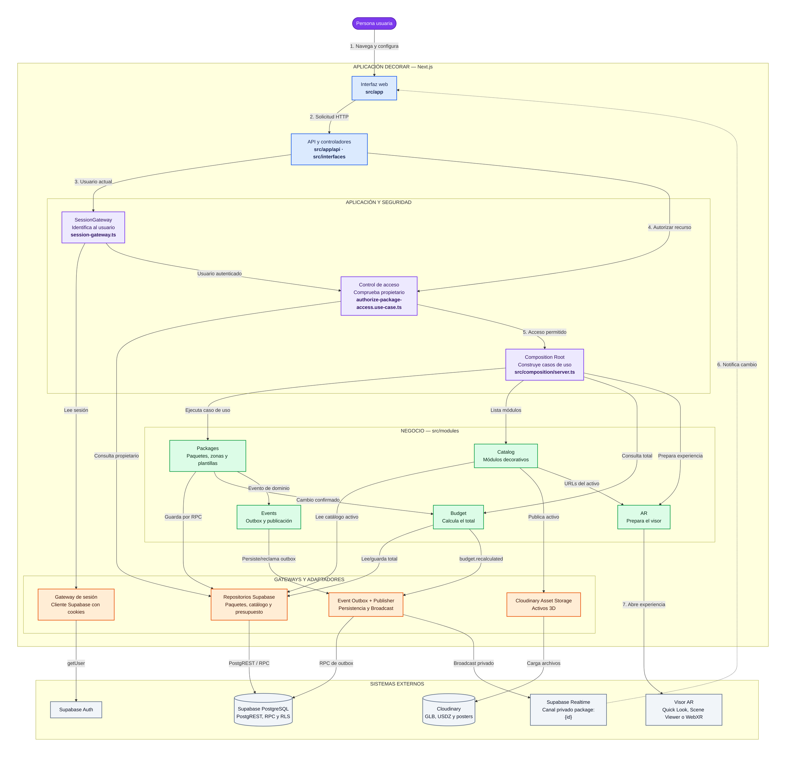

# C4 nivel 3: componentes principales

Vista simplificada del diseño interno de DecorAR. Muestra responsabilidades y dependencias importantes; omite clases auxiliares y detalles operativos.

> [Abrir el diagrama interactivo detallado](../../public/docs/components.html) — permite enfocar componentes, seguir rutas, cambiar tema y abrir la evidencia exacta del código. En producción: `/docs/components.html`.

El diagrama interactivo amplía esta vista con cuatro recorridos guiados: configuración de un evento, seguridad por capas, presupuesto en vivo y experiencia AR. El Mermaid siguiente permanece como respaldo ligero para lectores Markdown.



### Colores

- **Azul:** presentación y entradas.
- **Morado:** aplicación, composición y seguridad.
- **Verde:** lógica de negocio.
- **Naranja:** gateways y adaptadores.
- **Gris:** sistemas externos.

## Flujo principal para explicarlo

1. La persona usa la **interfaz web**, que envía una solicitud al controlador.
2. **SessionGateway** valida la sesión mediante Supabase Auth.
3. El **control de acceso** compara el usuario con el propietario del recurso.
4. El **Composition Root** proporciona el caso de uso y sus adaptadores.
5. El módulo aplica sus reglas; el gateway correspondiente traduce la operación hacia Supabase o Cloudinary.
6. Los cambios de Packages recalculan Budget y generan eventos durables.
7. Realtime notifica a la interfaz; AR abre el visor compatible cuando la persona lo solicita.

Flujo resumido:

```text
Usuario → Interfaz → Controlador → SessionGateway → Autorización
        → Caso de uso → Gateway específico → Sistema externo
```

### Relaciones internas importantes

```text
Packages → Budget: un cambio confirmado provoca el recálculo del total.
Packages → Events: el cambio deja un evento durable en el outbox.
Events → Realtime: el publicador envía el evento al canal privado del paquete.
Realtime → Interfaz: la pantalla recibe la notificación y actualiza el presupuesto.
Catalog → AR: entrega las URLs y datos del activo que debe visualizarse.
```

## Responsabilidades

| Componente | Responsabilidad principal |
|---|---|
| Interfaz web | Presenta catálogo, configuración, presupuesto y experiencia AR. |
| Entradas | Reciben solicitudes y delegan en los casos de uso. |
| Autenticación y autorización | `SessionGateway` valida la identidad; el control de acceso verifica la propiedad del paquete o plantilla. |
| Composition Root | Construye los casos de uso con sus gateways y adaptadores. |
| Paquetes y plantillas | Gestiona eventos, módulos decorativos, zonas, clonación y plantillas. |
| Catálogo | Gestiona los módulos disponibles y sus activos 3D. |
| Presupuesto | Calcula y conserva el costo del paquete. |
| Eventos | Guarda eventos en outbox y publica notificaciones privadas. |
| Realidad aumentada | Selecciona los activos y el visor compatible con el dispositivo. |
| Gateways y adaptadores | Aíslan los módulos de Supabase, Cloudinary y Realtime. |

## Decisiones clave

- Los módulos comparten una sola aplicación Next.js; no son microservicios.
- `SessionGateway` autentica. El control de acceso autoriza cada recurso.
- Los casos de uso dependen de gateways, no directamente de Supabase o Cloudinary.
- Supabase RLS añade una segunda barrera de seguridad.
- Los cambios de paquetes actualizan Presupuesto internamente; Realtime solo notifica a la interfaz.
- Los eventos reales son `package.module.added`, `package.module.removed`, `package.module.moved` y `budget.recalculated`.

## Ubicación en el código

| Área | Ruta |
|---|---|
| Interfaz y API | `src/app` |
| Controladores | `src/interfaces` |
| Composition Root | `src/composition/server.ts` |
| SessionGateway | `src/infrastructure/supabase/session-gateway.ts` |
| Módulos | `src/modules` |
| Adaptadores Supabase | `src/infrastructure/supabase` y `src/modules/*/infrastructure` |
